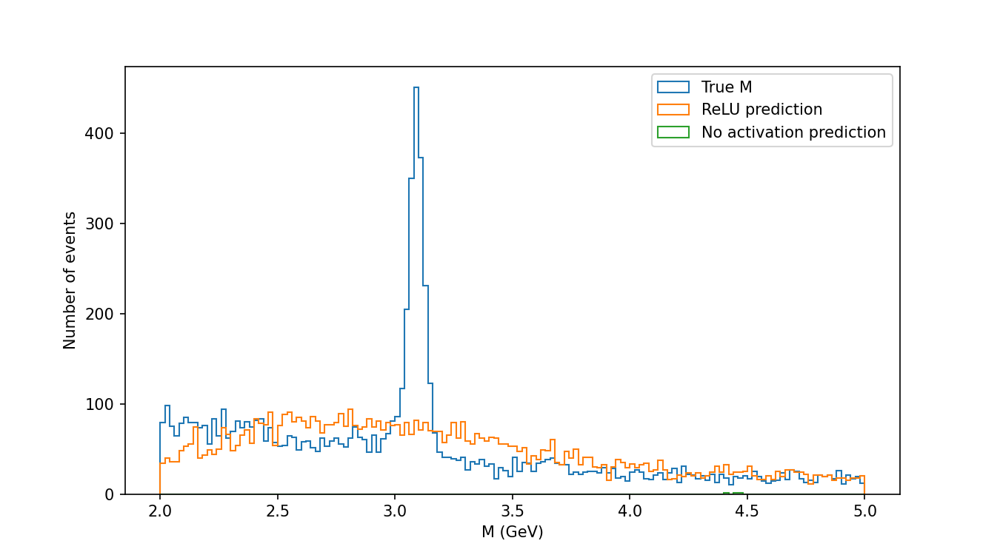
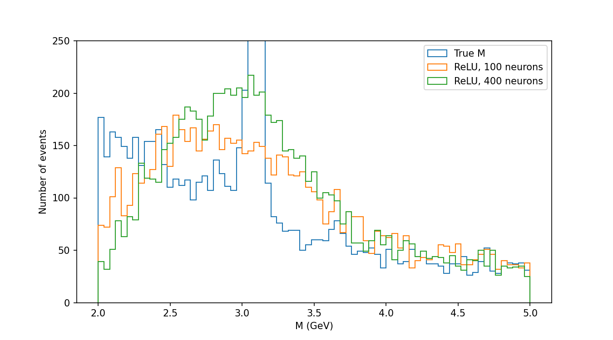

# Can a neural network learn the invariant mass formula?

**ReLU vs. no activation on CMS dimuon data** – KN Axion, Challenge 1, direction (b): model.

## Summary

A neural network gets the 8 raw measurements of two muons and has to predict their invariant mass M, without being given the formula. I compare the same network with and without an activation function (ReLU), and test whether the ReLU network gets more precise as it grows.

- **Without activation**, the network is no better than always predicting the average mass (R² ≈ 0.01), at every size. This matches the prediction.
- **With ReLU**, the network learns most of the relationship (R² ≈ 0.94), but its error in the J/ψ and Υ regions (≈ 1.3–2.5 GeV) is far above the precision needed to separate neighbouring resonances (≈ 0.3 GeV).
- **Growing the network** with the default training helped in the J/ψ region but not in a regular way, and not in the Υ region (Experiment 2).
- **With slower, longer training** (Experiment 3), R² rose to ≈ 0.98 and the J/ψ-region error fell steadily with size (1.16 → 1.01 → 0.76 GeV), as predicted. In the Υ region it did not, because one training run was thrown off by a single extreme event. The best run reached 0.57 GeV, still about twice the 0.29 GeV needed.
- Overall: the activation function makes a huge difference, and more neurons help when training is stable, but none of the networks tested is precise enough to separate neighbouring resonances.

## Data

CMS Open Data, 2010 LHC run, dimuon events: [CERN Open Data record 700](https://opendata.cern/record/700), file `MuRun2010B.csv` (100,000 events, invariant mass 2–110 GeV). Each event has two muons with energy E and momentum components px, py, pz.

The invariant mass of the pair is:

M² = (E1 + E2)² − (px1 + px2)² − (py1 + py2)² − (pz1 + pz2)²

### Exploratory analysis

Histograms of M show the known resonances (masses from the PDG):

| Particle | Mass (GeV) |
|---|---|
| J/ψ | 3.097 |
| ψ(2S) | 3.686 |
| Υ(1S) | 9.460 |
| Υ(2S) | 10.023 |
| Υ(3S) | 10.355 |
| Z | 91.19 |

Narrow spikes seen with 500 bins around 10.75 and 11.1 GeV disappeared with 80 bins, so they were treated as random fluctuations.

## Hypothesis

**Main claim (written on 20 October 2026, before any model was trained).** A neural network with ReLU activation can approximate the invariant-mass formula, and its ability to do so grows with the number of neurons. In the limit, the many "bends" created by ReLU neurons can follow the curve as closely as we want (the idea behind the universal approximation theorem). So as the number of neurons grows, the prediction error should decrease towards the precision needed to tell neighbouring resonances apart. The same network without activation stays a linear model no matter how many neurons it has, so its error should not improve with size.

**Why.** M contains squares and a square root, so it is non-linear. Without activation, all layers collapse into one linear formula, e.g. 2(3x + 1) + 5 = 6x + 7.

**Metrics.**
- R² on the whole test set (1 = perfect, 0 = no better than predicting the mean).
- RMSE (GeV) on test events with true M in 2–5 GeV (J/ψ, ψ(2S)) and in 8–12 GeV (Υ(1S), Υ(2S)).

**Thresholds.** Two equally wide peaks only look separate if their distance Δ is larger than about twice the error σ. So:
- J/ψ ↔ ψ(2S): Δ ≈ 0.59 GeV → RMSE < **0.29 GeV**
- Υ(1S) ↔ Υ(2S): Δ ≈ 0.56 GeV → RMSE < **0.28 GeV**

## Method

- scikit-learn `MLPRegressor`, 2 hidden layers, Adam optimizer.
- 80% / 20% train/test split; the test events are never seen during training.
- Inputs standardized with `StandardScaler`, fitted on the training set only (no data leakage).
- Each experiment is repeated with several fixed seeds (`random_state`); results are mean ± standard deviation.
- Only the activation (`relu` vs `identity`), the number of neurons, and in Experiment 3 the training settings are changed.
- The whole notebook: [`cms_dimuon_activation_ablation.ipynb`](cms_dimuon_activation_ablation.ipynb). Running the same seed twice gives exactly the same numbers.

## Experiment 1 – fixed size (100 neurons per layer, 5 seeds)

Prediction (fixed before running): ReLU reaches R² ≥ 0.99 and both RMSEs below the thresholds; without activation, both RMSEs stay above.

| Model | R² | RMSE 2–5 GeV | RMSE 8–12 GeV |
|---|---|---|---|
| ReLU | 0.935 ± 0.053 | 2.55 ± 1.54 | 2.13 ± 1.32 |
| No activation | 0.011 ± 0.039 | 7.79 ± 1.29 | 2.69 ± 1.06 |

**Result:** the prediction for the ReLU network was **refuted** (all three conditions failed). The prediction for the network without activation **held**: its R² ≈ 0 means it is no better than always guessing the average mass. The activation makes a huge difference (R² 0.01 → 0.94), but not enough to separate neighbouring peaks.  

## Experiment 2 – growing the network (100 / 200 / 400 neurons, 3 seeds)

This is the test of the main claim. Prediction: for ReLU, the mean RMSE decreases with size (100 > 200 > 400) in both regions; without activation it stays about the same.

| Neurons | ReLU RMSE 2–5 | ReLU RMSE 8–12 | No activation RMSE 2–5 |
|---|---|---|---|
| 100 | 2.10 ± 0.92 | 1.62 ± 0.42 | 7.43 ± 1.57 |
| 200 | 2.48 ± 2.00 | 3.30 ± 2.13 | 8.08 ± 0.48 |
| 400 | 1.31 ± 0.25 | 2.41 ± 2.42 | 8.07 ± 1.80 |

**Result: mixed.**
- Without activation: no improvement with size. **Held.**
- ReLU, 2–5 GeV: 400 neurons is clearly best and most stable (all three seeds ≤ 1.46 GeV), but 200 is worse than 100, so the decrease is not regular.
- ReLU, 8–12 GeV: 400 is not better than 100. **Refuted in this region.**
- Per seed, seed 1 shows exactly the predicted steady decrease in both regions (2–5: 1.48 → 1.41 → 1.02; 8–12: 1.15 → 0.88 → 0.66). Seeds 0 and 2 do not. Picking seed 1 after seeing the results would be cherry-picking, so the mean over all seeds is what counts.

## Experiment 3 – is the training method the problem? (100 / 200 / 400 neurons, 3 seeds)

Added after Experiment 2, written down before running. Only the training changes: learning rate 0.0003 (instead of 0.001), up to 600 epochs (instead of 200), stop after 50 epochs without improvement (instead of 10). Prediction: mean RMSE decreases 100 > 200 > 400 in both regions.

| Neurons | R² | RMSE 2–5 GeV | RMSE 8–12 GeV |
|---|---|---|---|
| 100 | 0.983 ± 0.001 | 1.16 ± 0.36 | 0.82 ± 0.02 |
| 200 | 0.985 ± 0.003 | 1.01 ± 0.26 | 1.10 ± 0.81 |
| 400 | 0.978 ± 0.022 | 0.76 ± 0.33 | 1.91 ± 2.34 |

**Result:**
- Training matters: every setting improved compared with Experiment 2 (e.g. R² 0.94 → 0.98 at 100 neurons).
- ReLU, 2–5 GeV: the mean error decreases steadily, 1.16 > 1.01 > 0.76 GeV. **Held in this region.** It is still above the 0.29 GeV threshold.
- ReLU, 8–12 GeV: 0.82 → 1.10 → 1.91 GeV, so the error does not decrease. **Refuted in this region.** The increase comes from seed 2 alone (2.04 GeV at 200 neurons, 4.61 GeV at 400); seeds 0 and 1 decrease steadily (e.g. seed 1: 0.80 → 0.58 → 0.46 GeV).
- So, by the rule fixed before running, the main claim is supported in the J/ψ region and refuted in the Υ region.

### Why did seed 2 fail in the Υ region? (diagnosis, added after the results)

I retrained the worst case (400 neurons, seed 2, Experiment 2 settings, RMSE 5.17 GeV in 8–12 GeV) and listed the test events with the largest errors. Almost the whole error comes from **one event**: true M = 11.3 GeV, predicted M = 331 GeV. Its first muon has E1 ≈ 3384 GeV, while the largest E1 in the training set is about 1526 GeV. The network never saw such an input, so it had to extrapolate, and it did so badly. Without the five worst events, the RMSE in this region drops from 5.17 to 0.61 GeV. A muon with transverse momentum of about 700 GeV in a pair with mass 11 GeV is most likely a mismeasured track.

Conclusion: the failure in the Υ region is caused by a rare extreme input, not by the network size. RMSE is very sensitive to such single events. Planned fix (stratified split) was dropped, because the problem is not how the events are divided between training and test.

## Why is precise prediction hard? (discussion)

For a low-mass pair, M comes from a tiny difference between two large numbers. Example: two muons from a J/ψ with about 10 GeV each give (E1 + E2)² = 400 and |p1 + p2|² ≈ 391. The difference is 9, so M = 3 GeV. A 1% error on 400 already moves M to 2.2 or 3.6 GeV. To reach 0.29 GeV, the network would have to compute these large quantities to about one part in a thousand. A ReLU network approximates the curve with straight pieces, and training finds the pieces step by step, sometimes ending in a poor solution. That explains both the error size and the large spread between seeds.

## Additional observations (added after seeing the results, not part of the hypothesis)

- **J/ψ ↔ Υ(1S) separation:** these peaks are about 6.4 GeV apart, so the same rule gives a threshold of about 3.2 GeV. In Experiment 1 the ReLU network (2.55 / 2.13 GeV) is below it and the network without activation (7.79 GeV in 2–5 GeV) is above it. So ReLU can tell J/ψ from Υ, while the network without activation cannot.
- **Z region (80–100 GeV), seed 0, 100 neurons:** 89 test events. ReLU (Experiment 3 training) RMSE 7.34 GeV (8.0% of 91.19 GeV); no activation 75.35 GeV (82.6%). There is no neighbouring peak, so no threshold. For reference, the natural width of the Z is about 2.5 GeV, so even the ReLU error is about three times larger. Very few training events lie in this region (about 360 of 80,000).
- **Predicted-mass histogram (2–5 GeV), same runs:** the sharp J/ψ peak at 3.1 GeV is not visible in the ReLU predictions; with an error of about 1 GeV it is smeared into a broad bump. Most predictions of the network without activation fall outside 2–5 GeV. This is the threshold argument seen directly: with an error well above 0.29 GeV, peaks disappear.

  

- **100 vs. 400 neurons, same seed (seed 0, Experiment 3 training):** the predicted bump around 3 GeV is higher with 400 neurons, but the error is not smaller (1.10 vs. 1.14 GeV). The 400-neuron network also pushes events from around 2 GeV up towards 3 GeV. A higher bump is not the same as a more accurate prediction; only the mean over seeds (Experiment 3) shows the improvement with size. Two separate peaks are not visible in either case.

  

## Future work

- Larger networks (800 neurons and more) with several seeds, to see whether the J/ψ-region error keeps falling towards 0.29 GeV.
- Removing or flagging extreme inputs (e.g. quality cuts on muon momentum) before training, then repeating Experiment 3.
- Giving the network more useful inputs (e.g. the summed energy and momentum of the pair), which would be a new hypothesis about the data rather than the model.

## Limitations

- Only one network type (2 hidden layers, Adam) and one dataset.
- Few seeds per setting (3–5); the spread between seeds is large.
- RMSE is very sensitive to single extreme events (see the diagnosis).
- The additional observations use a single seed and were added after seeing the results.
- The universal approximation theorem says a good approximation exists; these experiments can only test what training actually finds with a finite number of neurons.

## References

- CMS Collaboration, dimuon events from Run2010B, CERN Open Data Portal, record 700: https://opendata.cern/record/700
- Particle Data Group, Review of Particle Physics (masses of J/ψ, ψ(2S), Υ, Z).
- G. Cybenko, "Approximation by superpositions of a sigmoidal function", 1989.
- M. Leshno, V. Lin, A. Pinkus, S. Schocken, "Multilayer feedforward networks with a nonpolynomial activation function can approximate any function", 1993.
